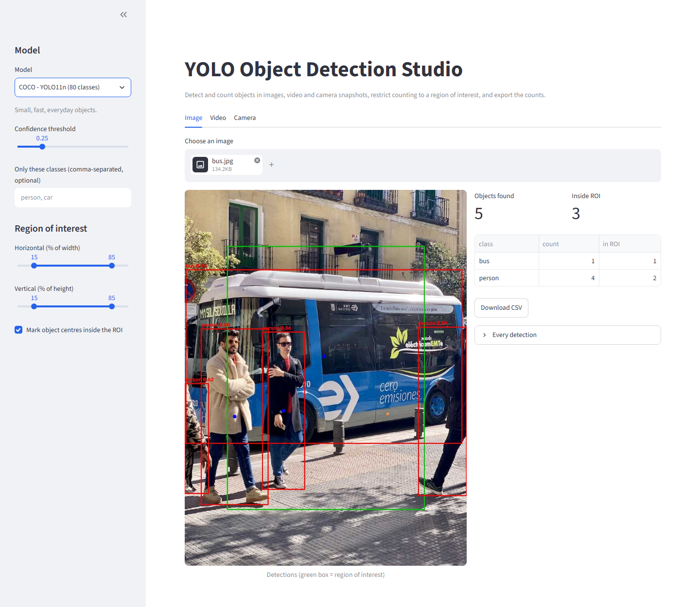
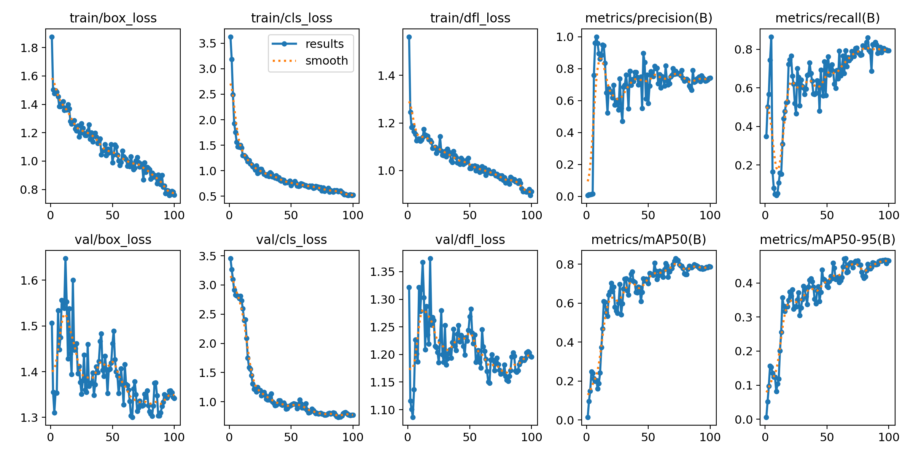
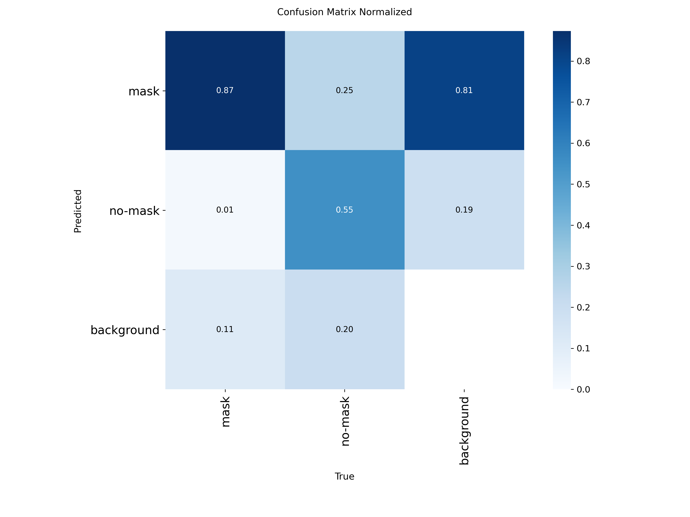
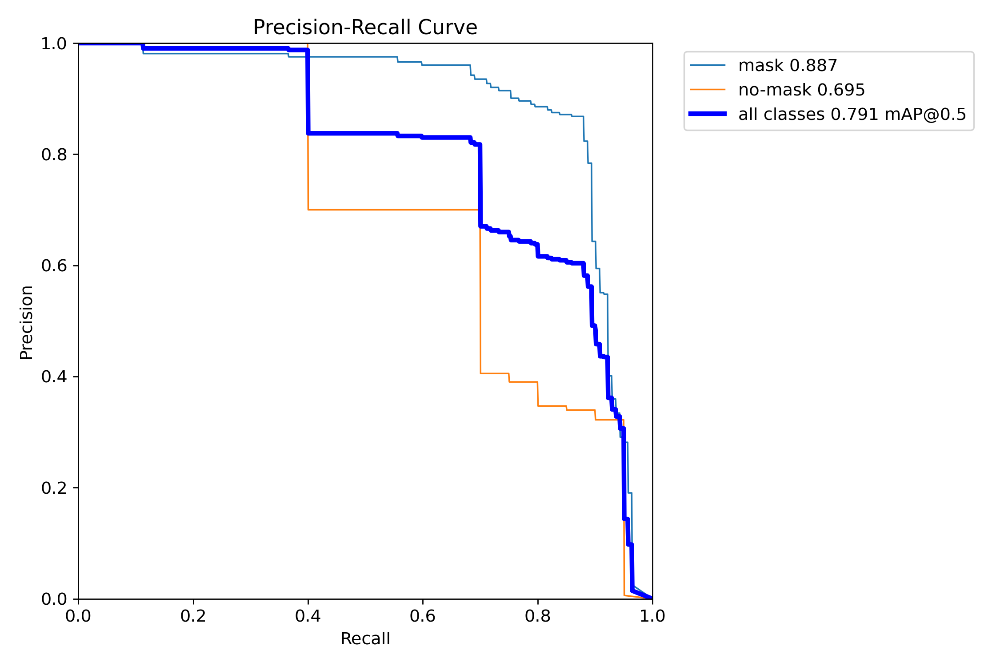

# YOLO Object Detection Studio

[](https://github.com/madhur0770/YOLO_Object-Detection/actions/workflows/ci.yml)

**A Streamlit app for detecting and counting objects with YOLO models: upload an image or video, or take a camera snapshot, restrict counting to a region of interest, and export the counts as CSV. Includes a custom-trained mask detector and the training pipeline behind it.**



*Image tab on a sample photo (COCO YOLO11n): 5 objects found, 3 whose centre is inside the green region of interest.*

## Features

- **Six selectable models:** a custom-trained mask / no-mask detector (YOLO11n), four Open Images v7 models (nano to extra large, 600 classes) and COCO YOLO11n (80 classes).
- **Three inputs:** image upload, video upload (every Nth frame, with a progress bar) and a browser camera snapshot.
- **Region of interest (ROI):** set as a percentage of the frame, so it works at any resolution. An object counts as "inside" when its centre is strictly inside the box.
- **Counting you can trust on video:** reports the *peak count per frame*, the total detections, and, with tracking on, the number of *unique* objects.
- **Class filter**, confidence slider, bounding boxes with labels and centre markers.
- **CSV export** for images and for whole videos.
- **Reproducible training:** `scripts/train.py` and `scripts/download_dataset.py`, plus the real training curves and metrics for the bundled model.

## Technology stack

Python, [Ultralytics YOLO](https://github.com/ultralytics/ultralytics) (PyTorch), OpenCV, Streamlit. Tests use the standard-library `unittest`.

## Quick start

```bash
git clone https://github.com/madhur0770/YOLO_Object-Detection.git
cd YOLO_Object-Detection
python -m venv .venv
# Windows: .venv\Scripts\activate      macOS/Linux: source .venv/bin/activate
pip install -r requirements.txt
streamlit run app.py
```

Public model weights (the Open Images and COCO models) download automatically the first time you select them. The mask detector is bundled in `models/`.

### With Docker

```bash
docker build -t yolo-studio .
docker run -p 8501:8501 yolo-studio     # then open http://localhost:8501
```

### Deploying

The repository includes `packages.txt` (the system library OpenCV needs) so it can run on [Streamlit Community Cloud](https://streamlit.io/cloud): create an app from this repository with `app.py` as the entry point. Use the nano or medium models there; the large ones need more memory than free hosting provides. The `Dockerfile` also works on any container host, for example a Hugging Face Docker Space. This repository does not currently have a hosted demo link.

## The mask detector

The bundled model, `models/mask-detector-yolo11n.pt`, is YOLO11n fine-tuned for 100 epochs at 640 px (batch 16, from pretrained weights) on the [mask-wearing dataset](https://universe.roboflow.com/joseph-nelson/mask-wearing/dataset/1) (Roboflow Universe, public domain). Two classes: `mask`, `no-mask`.

Metrics on the dataset's validation split, from the training log (`docs/assets/training-results.csv`). The saved weights are the best epoch (65):

| Precision | Recall | mAP50 | mAP50-95 |
|---:|---:|---:|---:|
| 0.726 | 0.794 | 0.792 | 0.472 |

By the final epoch (100) the figures were 0.741 / 0.794 / 0.787 / 0.466, so training had plateaued. These are validation-split numbers measured during training, not an independent test-set evaluation.





To retrain:

```bash
pip install roboflow
export ROBOFLOW_API_KEY=your-key            # PowerShell: $env:ROBOFLOW_API_KEY = "your-key"
python scripts/download_dataset.py
python scripts/train.py --data datasets/mask-wearing/data.yaml --model yolo11n.pt --epochs 100 --device 0
```

The API key is read from the environment and never stored in the repository.

## Architecture

```
app.py                    Streamlit interface (image / video / camera tabs, sidebar settings)
yolostudio/
  counting.py             Detection, Roi, Aggregator, CSV builders: pure Python, no model needed
  inference.py            run a model, convert Ultralytics results to Detection objects, draw annotations
  models.py               the models offered in the app
scripts/                  training and dataset download
models/                   bundled mask detector weights
tests/                    unit tests + real-model checks run in CI
```

All counting and logging logic lives in `counting.py` and operates on plain `Detection` objects, so it is tested without PyTorch. `inference.detect` is the only place that talks to the model, and it is tested with fakes locally and with real weights in CI.

## Testing

```bash
python -m unittest discover -s tests -v
```

GitHub Actions runs the unit and Streamlit UI tests on Windows and Linux (Python 3.11 and 3.12). A separate job downloads real weights and checks that YOLO11n finds a person and a bus in a sample photo, that the bundled mask model loads with the right classes, and that tracking assigns IDs. A third job builds the Docker image and waits for Streamlit's health endpoint. Set `YOLO_REAL_TESTS=1` to run the real-model tests locally.

## Limitations

- Accuracy depends on the model. The mask detector is trained on a small public dataset and is a demonstration, not a safety system.
- The camera tab analyses snapshots; it is not a continuous live stream.
- Large models are slow on CPU. Video is processed on the server that runs the app.
- Tracking uses Ultralytics' built-in tracker with default settings. Unique-object counts can be inflated when a tracker loses and re-acquires an object.
- Third-party licences apply: Ultralytics YOLO and its pretrained weights are released under AGPL-3.0, and the Open Images and COCO weights follow Ultralytics' terms. Check them before using this in a commercial product.

## Future improvements

- Annotated video export.
- Tracker choice and settings in the interface.
- A held-out test-set evaluation script for custom models.

## Author

Madhur Kumar Rana
